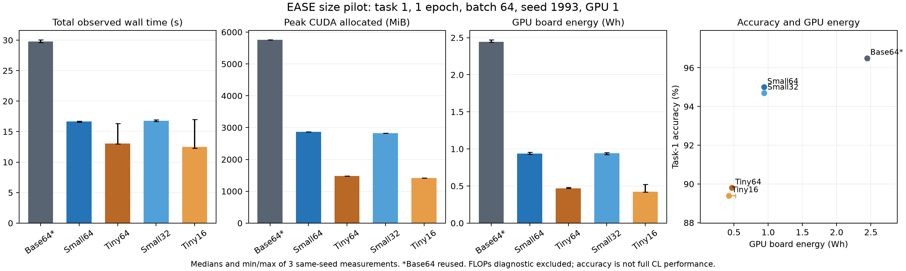

# EASE 크기별 구현 검증·효율성 결과 — 2026-10-07

Small64·Tiny64·Small32·Tiny16의 독립 기준선4회, native 검증4회, 효율성 측정12회와 별도 FLOPs 진단4회를 완료했습니다. Base64는 앞서 검증한 결과를 재사용합니다. 모든 모델은 같은 CIFAR100-224 첫 태스크로 비교합니다.

## 같은 설정 기준선과 native 비교

각 크기·adapter 설정의 저자 코드 기준선과 native를 첫2태스크·20epoch/task·batch48·seed1993·workers4로 비교했습니다. 기준선 대비 정확도 하락≤1.5%p는 통과, 1.5~3.0%p는 추가 점검, >3.0%p는 실패입니다. 구조 검사가 실패하면 정확도와 관계없이 실패로 취급합니다.

| 설정 | T1 기준선/native | T2 전체 기준선/native | T2 이전 기준선/native | T2 신규 기준선/native | 판정 |
|---|---:|---:|---:|---:|---|
| Small64 | 98.60% / 98.50% | 95.50% / 95.40% | 95.60% / 95.90% | 95.40% / 94.90% | pass |
| Tiny64 | 96.60% / 96.20% | 91.00% / 91.10% | 90.00% / 89.50% | 92.00% / 92.70% | pass |
| Small32 | 98.50% / 98.50% | 95.35% / 95.45% | 95.70% / 95.60% | 95.00% / 95.30% | pass |
| Tiny16 | 96.30% / 96.40% | 90.20% / 90.75% | 88.10% / 89.20% | 92.30% / 92.30% | pass |

Tiny·Small 기준선은 고정한 저자 구현의 생성자 차원·head 수와 classifier block 폭 기본값만 변경한 독립 size variant입니다. 논문에 보고된 Tiny·Small 성능 재현으로 표기하지 않습니다. Native와 기준선의 canonical 사전학습 텐서150개가 일치해야 합니다.

## 첫 태스크 효율성

다음은 첫10클래스·train5000/test1000·1epoch·batch64·workers4·seed1993의 측정3회 중앙값입니다. 같은 seed의 반복으로 실행 비용 변동을 측정하며 seed간 정확도 변동을 추정하지 않습니다. 별도 FLOPs 진단의 시간·메모리·에너지는 집계에서 제외합니다.

| 설정 | 1epoch 정확도 | 전체 관측(s) | 학습(s) | Prototype/종료(s) | 평가(s) | CUDA allocated peak(MiB) | GPU 에너지(Wh) | 부분 FLOPs(TFLOP) |
|---|---:|---:|---:|---:|---:|---:|---:|---:|
| Base64 (기존 결과) | 96.50% | 29.763 | 13.343 | 6.541 | 1.464 | 5760.51 | 2.443184 | 562.696 |
| Small64 | 95.00% | 16.690 | 5.688 | 2.665 | 0.687 | 2868.09 | 0.938305 | 150.977 |
| Tiny64 | 89.80% | 13.063 | 3.103 | 1.534 | 0.466 | 1483.67 | 0.468390 | 42.896 |
| Small32 | 94.70% | 16.772 | 5.657 | 2.666 | 0.697 | 2823.53 | 0.940867 | 148.561 |
| Tiny16 | 89.40% | 12.522 | 3.078 | 1.515 | 0.464 | 1417.94 | 0.424519 | 41.084 |

| 설정 | CPU time(s) | RSS 합계 peak(MiB) | CUDA reserved peak(MiB) | 관측 시간 범위(s) | GPU 에너지 범위(Wh) | 전력 sampling coverage 범위 |
|---|---:|---:|---:|---:|---:|---:|
| Base64 (기존 결과) | 41.857 | 13355.50 | 6036.00 | 29.592~30.068 | 2.437814~2.472424 | 99.82~99.83% |
| Small64 | 28.453 | 11479.40 | 3058.00 | 16.554~16.716 | 0.928255~0.955661 | 99.71~99.73% |
| Tiny64 | 24.999 | 11518.52 | 1646.00 | 12.995~16.353 | 0.466404~0.479967 | 99.58~99.70% |
| Small32 | 28.600 | 11517.39 | 2982.00 | 16.684~16.931 | 0.925686~0.951339 | 99.79~99.80% |
| Tiny16 | 24.708 | 11516.93 | 1576.00 | 12.285~17.022 | 0.417281~0.523075 | 99.60~99.75% |

| 설정 | 태스크 시작 학습 파라미터 | 모델 파라미터 합계 | 등록 buffer(bytes) | 태스크 종료 momentum state(bytes) |
|---|---:|---:|---:|---:|
| Base64 (기존 결과) | 1,197,313 | 86,995,969 | 30,741 | 4,789,252 |
| Small64 | 599,041 | 22,264,705 | 15,381 | 2,396,164 |
| Tiny64 | 299,905 | 5,824,321 | 7,701 | 1,199,620 |
| Small32 | 303,745 | 21,969,409 | 15,381 | 1,214,980 |
| Tiny16 | 78,145 | 5,602,561 | 7,701 | 312,580 |

기본 adapter64 비교는 Base64/Small64/Tiny64이고, 폭 비율 정렬 비교는 Base64/Small32/Tiny16입니다. Base64는 두 그룹에 공통으로 포함되는 같은 결과입니다. 모든 크기에 AugReg IN21K→IN1K 가중치를 사용하지만 크기별 원래 augmentation·학습 recipe는 다르며 그 차이를 [체크포인트 기록](environment/checkpoints.json)에 보존했습니다.

## 관측한 비교

Small64는 Base64 대비 전체 관측 시간 약44%, CUDA allocated peak 약50%, GPU 보드 에너지 약62%를 줄였지만 1epoch 정확도는1.50%p 낮았습니다. Tiny64는 비용이 더 작고 1epoch 정확도 차이도 더 큽니다. 이 비교는 같은 가중치 계열의 서로 다른 크기이며 크기별 사전학습 recipe 차이도 함께 존재합니다.

Small64→Small32는 학습 파라미터599,041→303,745로 약49% 감소하지만 부분 FLOPs는 약1.6%, CUDA allocated peak는 약1.6%만 감소했습니다. 학습 phase 시간은 비슷했고 전체 시간·에너지 범위도 겹칩니다. 이번 단기 측정에서 파라미터 수 감소를 그대로 연산 비용 감소로 해석할 수 없습니다. Tiny64→Tiny16도 같은 구분으로 살펴볼 수 있습니다.

[PDF 그래프](efficiency_comparison.pdf)

## 지표의 범위

전체 관측 시간은 Recorder 구간으로 import·초기화·W&B 시작·학습·prototype·평가·감사·로컬 기록을 포함하고 마지막 artifact 업로드/finish는 제외합니다. CPU time은 프로세스와 종료한 자식 프로세스의 user+system 시간 합계이며 벽시계 시간과 다릅니다. RSS는 프로세스별 합계라 공유 페이지가 중복 계산될 수 있습니다. CUDA allocated와 reserved는 PyTorch 값이고 GPU device memory는 별도 raw 지표로 보존합니다.

GPU 에너지는 선택한 물리 GPU 보드의 sampled power 적분이며 idle 전력도 포함합니다. CPU/RAM이나 전체 머신의 에너지는 아닙니다. 누락 구간을 외삽하지 않으며 짧은 phase의1초 sampling은 정밀한 단독 phase 전력 측정으로 해석하지 않습니다. 전체 중앙값과 각 phase 중앙값은 합산 관계가 아닙니다.

FLOPs는 torch.profiler가 지원하는 연산의 부분 합계로 학습·prototype·평가·감사 등의 경로가 포함됩니다. 전체 FLOPs나 학습만의 FLOPs로 표기하지 않으며 backward에 임의 배수를 곱하지 않았습니다. FP32 파라미터·autocast 없음·CUDA matmul TF32 off·cuDNN TF32 허용·deterministic=True·benchmark=False를 공통 적용했습니다.

1epoch 정확도는 효율성 pilot 결과입니다. 20epoch 구현 검증 기준과 별도로 보고하며 full CL 성능·forgetting을 추정하지 않습니다.

## 원시 결과와 원격 저장

[JSON](results.json) · [측정 CSV](measurements.csv) · [검증 CSV](validation.csv)에 각 관측값·범위·checkpoint/source hash·W&B URL을 저장합니다. 새 원시 로그는 [ease-size-pilot-20261007T024856Z](/mnt/sdab1/userHome/wslim/.codex/worktrees/aa40/compression-gap-cl/.worktrees/ease-sizes/benchmarks/cl_efficiency/ease_sizes/runs/ease-size-pilot-20261007T024856Z)에 보존하며 Git 병합으로 복사하지 않습니다. 모든 worktree는 공유 데이터·캐시 경로를 재사용합니다. 이 단계 준비에서 Small/Tiny 가중치 두 파일을 새로 다운로드했고, 실험 worker는 고정한 로컬 가중치를 사용합니다.

| 설정 | 기준선 | Native 검증 | 측정1 / 2 / 3 | FLOPs |
|---|---|---|---|---|
| Base64 (기존 결과) | [기존 검증](../ease/native_validation_report.md) | [기존 결과](../ease/efficiency_pilot_report.md) | [측정1](https://wandb.ai/laymond1/cl-efficiency/runs/zrctmk8h) / [측정2](https://wandb.ai/laymond1/cl-efficiency/runs/fzn84ciy) / [측정3](https://wandb.ai/laymond1/cl-efficiency/runs/qitfg8hb) | [W&B](https://wandb.ai/laymond1/cl-efficiency/runs/tuk4smi4) |
| Small64 | [W&B](https://wandb.ai/laymond1/cl-efficiency/runs/nfr0uipo) | [W&B](https://wandb.ai/laymond1/cl-efficiency/runs/mug37yfy) | [측정1](https://wandb.ai/laymond1/cl-efficiency/runs/8wfhrbmd) / [측정2](https://wandb.ai/laymond1/cl-efficiency/runs/eylsj2af) / [측정3](https://wandb.ai/laymond1/cl-efficiency/runs/nmv8j5vh) | [W&B](https://wandb.ai/laymond1/cl-efficiency/runs/fc0wdcqw) |
| Tiny64 | [W&B](https://wandb.ai/laymond1/cl-efficiency/runs/vf4oa8yx) | [W&B](https://wandb.ai/laymond1/cl-efficiency/runs/9ba84j7l) | [측정1](https://wandb.ai/laymond1/cl-efficiency/runs/7wtjphu7) / [측정2](https://wandb.ai/laymond1/cl-efficiency/runs/5e09puo4) / [측정3](https://wandb.ai/laymond1/cl-efficiency/runs/6pq2tjrf) | [W&B](https://wandb.ai/laymond1/cl-efficiency/runs/41g34uly) |
| Small32 | [W&B](https://wandb.ai/laymond1/cl-efficiency/runs/sjjzd977) | [W&B](https://wandb.ai/laymond1/cl-efficiency/runs/kwltkuec) | [측정1](https://wandb.ai/laymond1/cl-efficiency/runs/lka2qolh) / [측정2](https://wandb.ai/laymond1/cl-efficiency/runs/ijyoav79) / [측정3](https://wandb.ai/laymond1/cl-efficiency/runs/2ykpu9u5) | [W&B](https://wandb.ai/laymond1/cl-efficiency/runs/vvijbhie) |
| Tiny16 | [W&B](https://wandb.ai/laymond1/cl-efficiency/runs/fngkcmzs) | [W&B](https://wandb.ai/laymond1/cl-efficiency/runs/80lstk1e) | [측정1](https://wandb.ai/laymond1/cl-efficiency/runs/gaasw51w) / [측정2](https://wandb.ai/laymond1/cl-efficiency/runs/kb7gb6e5) / [측정3](https://wandb.ai/laymond1/cl-efficiency/runs/ymcttimf) | [W&B](https://wandb.ai/laymond1/cl-efficiency/runs/a38usjsp) |

실행 소스는 `4d60f96`이며 실행 전 모델·검증·효율성 집중 테스트750개와 독립/native 실제 CPU 생성 검증8개를 통과했습니다. 구체적인 명령은 [사전 점검](environment/preflight.json)에 보존합니다. [정확도·state 독립 감사](environment/accuracy_state_audit.json)에서16개 체크포인트의 finite 상태·canonical150 텐서·이전 adapter·기존 prototype 보존을 확인했습니다. [독립 자원·원격 감사](environment/independent_pilot_audit.json)와 [소스·센서 보완 감사](environment/pin_sensor_audit.json)에서24 run finished·24 artifact COMMITTED·216파일 readback을 확인했습니다. Slack suite 요청64개와 태스크 알림16개도 모두 sent입니다. 측정12회 전력 coverage 최솟값은99.5768%입니다.

Small64 기준선의 최초 시도는 저자 classifier 폭 기본값768이 남아 있어 첫 평가에서 실패했습니다. [실패 시도 기록](failed_attempts.json)에 로컬/W&B 로그와 제외 사유를 보존하고, 폭 기본값만 크기에 맞춰 수정한 뒤 재실행했습니다. 이 실패 시도의 시간·메모리·에너지는 위 결과에 포함하지 않습니다.

검증한 소스와 결과를 `codex/cl-foundation`에 로컬 병합합니다. 실제 완료 커밋과 명령은 `checks.md`에 별도로 기록합니다. 추가 seed·전체 CL·HiDe-Prompt·BudgetCL/aL-SAR·원격 push는 실행 범위에 포함하지 않습니다.

[W&B 집계 보고서](https://wandb.ai/laymond1/cl-efficiency/runs/nyk1kr3q)에 기존 관측값의 중앙값·범위·검증 결과를 저장합니다. 집계 업로드는 추가 학습이 아닙니다.
