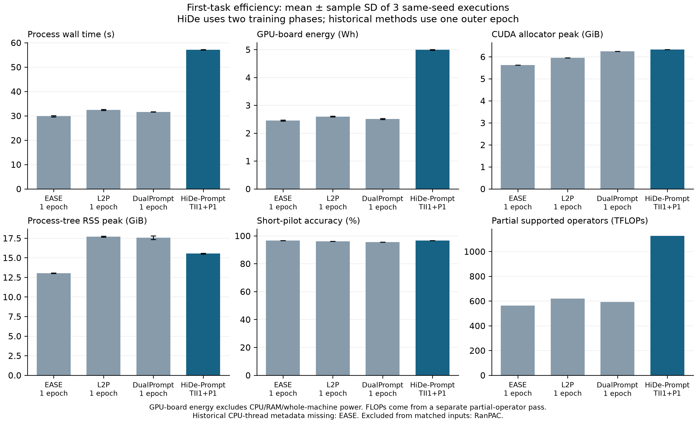

# HiDe-Prompt 실행 결과

정확도 판정: **pass**. 실제 첫 배치 입력·라벨·seed 대조: **pass**.

검증 조건은 Base ViT-B/16, 동일 IN21K→IN1K 가중치, CIFAR100 첫 2태스크, seed1993, batch64입니다. 태스크마다 TII20 + prompt50, 태스크2에서 두 정렬 각각 30epoch을 계획한 독립 저자 코드 비교이며, 실제 완료 상태와 비용은 아래에 표시합니다. 논문 수치 재현과 구분합니다.

| 정확도 지표 | 저자 코드 (%) | 현재 구현 (%) | 저자−현재 (%p) | 판정 |
|---|---:|---:|---:|---|
| task1_seen | 99.400 | 99.400 | 0.000 | pass |
| task2_seen | 97.950 | 97.950 | 0.000 | pass |
| task2_old | 98.900 | 98.900 | 0.000 | pass |
| task2_new | 97.000 | 97.000 | 0.000 | pass |

판정은 저장된 정답 수/샘플 수의 정확한 분수로 계산했습니다. 1.5%p 이내 통과, 1.5~3.0%p 추가 점검, 3.0%p 초과 실패이며 구조 검증 실패도 통과를 차단합니다.

| 검증 실행 | 상태 | W&B | 벽시간 (s) | GPU 보드 에너지 (Wh) | CUDA peak (MiB) |
|---|---|---|---:|---:|---:|
| reference | completed | [run](https://wandb.ai/laymond1/cl-efficiency/runs/eiil7wjc) | 2268.779 | 261.670 | 6437.040 |
| native | completed | [run](https://wandb.ai/laymond1/cl-efficiency/runs/iw6ohxji) | 2260.442 | 261.660 | 6486.240 |

### 검증 단계 비용

두 태스크의 누적 단계 비용입니다. 정렬은 첫 태스크에서 해당 없음이며 실제 정렬 작업은 태스크2에만 발생합니다. 타이머가 중첩되므로 단계 합계는 총 비용과 다릅니다.

| 단계 | 저자 코드 시간 (s) | 현재 구현 시간 (s) | 현재 구현 GPU 보드 (J) |
|---|---:|---:|---:|
| tii_train | 274.697 | 274.128 | 108928.839 |
| tii_statistics | 17.093 | 17.311 | 6107.810 |
| tii_alignment | 11.494 | 4.419 | 596.722 |
| prompt_train | 1915.406 | 1919.677 | 815089.726 |
| prompt_finalize | 0.000 | 0.002 | 0.826 |
| prompt_statistics | 17.446 | 17.304 | 6149.222 |
| prompt_alignment | 12.371 | 4.219 | 629.978 |
| evaluation | 7.882 | 7.952 | 2885.645 |
| checkpoint | 0.166 | 3.239 | 634.069 |

## 첫 태스크 효율성

HiDe는 TII1+prompt1, batch64, 공통 `ease` 전처리로 측정했습니다. 두 통계 추출과 실제 TII routing 비용을 포함하며 첫 태스크 정렬은 해당 없음입니다. 기존 방법은 1 outer epoch이므로 동일 계산 예산 비교가 아닙니다.

아래 수치는 같은 seed의 측정 3회 **평균 ± 표본 표준편차**입니다. 별도 FLOPs 실행의 시간·메모리·에너지는 집계에서 제외했습니다.

| 방법 | 정확도 (%) | 벽시간 (s) | GPU 보드 (Wh) | CUDA peak (GiB) | RSS peak (GiB) | 부분 FLOPs (TF) |
|---|---:|---:|---:|---:|---:|---:|
| EASE (기존 측정 재사용) | 96.500 ± 0.000 | 29.808 ± 0.241 | 2.451 ± 0.019 | 5.625 ± 0.000 | 13.032 ± 0.024 | 562.696 |
| L2P (기존 측정 재사용) | 96.000 ± 0.000 | 32.376 ± 0.220 | 2.595 ± 0.015 | 5.956 ± 0.000 | 17.693 ± 0.063 | 618.443 |
| DualPrompt (기존 측정 재사용) | 95.400 ± 0.000 | 31.606 ± 0.075 | 2.508 ± 0.018 | 6.248 ± 0.000 | 17.571 ± 0.235 | 591.147 |
| HiDe-Prompt (TII1+P1) | 96.600 ± 0.000 | 57.093 ± 0.152 | 4.992 ± 0.015 | 6.334 ± 0.000 | 15.526 ± 0.044 | 1126.989 |

### HiDe 단계 비용

단계 타이머는 포함 관계가 있으므로 합산하여 총 비용으로 해석하지 않습니다. 짧은 단계에서 power sample이 겹치지 않으면 에너지는 미측정으로 남깁니다.

| 단계 | 시간 (s) | GPU 보드 에너지 (J) | 에너지 관측 시간 (s) |
|---|---:|---:|---:|
| acceptance_audit | 2.212 ± 0.037 | 433.162 ± 60.189 | 2.212 ± 0.037 |
| begin_epoch | 0.001 ± 0.000 | 0.293 ± 0.008 | 0.001 ± 0.000 |
| begin_task | 0.012 ± 0.000 | 0.785 ± 0.062 | 0.012 ± 0.000 |
| checkpoint | 1.526 ± 0.035 | 273.542 ± 47.621 | 1.526 ± 0.035 |
| data_audit | 0.026 ± 0.001 | 1.739 ± 0.114 | 0.026 ± 0.001 |
| data_loading | 0.796 ± 0.007 | 50.222 ± 2.069 | 0.796 ± 0.007 |
| end_epoch | 8.449 ± 0.012 | 2991.562 ± 19.927 | 8.449 ± 0.012 |
| end_task | 8.371 ± 0.050 | 3009.711 ± 11.561 | 8.371 ± 0.050 |
| epoch_audit | 0.004 ± 0.000 | 1.723 ± 0.119 | 0.004 ± 0.000 |
| evaluation | 2.622 ± 0.002 | 872.246 ± 21.386 | 2.622 ± 0.002 |
| first_batch_audit | 0.079 ± 0.001 | 11.946 ± 0.188 | 0.079 ± 0.001 |
| initialize | 1.394 ± 0.007 | 43.634 ± 6.817 | 1.394 ± 0.007 |
| prompt_alignment (해당 없음; hook 오버헤드는 총 비용에 포함) | N/A | N/A | N/A |
| prompt_alignment_audit | 0.000 ± 0.000 | 0.109 ± 0.005 | 0.000 ± 0.000 |
| prompt_finalize | 0.001 ± 0.000 | 0.377 ± 0.014 | 0.001 ± 0.000 |
| prompt_statistics | 8.367 ± 0.050 | 3008.320 ± 11.581 | 8.367 ± 0.050 |
| prompt_train | 19.108 ± 0.030 | 7917.740 ± 8.110 | 19.108 ± 0.030 |
| tii_alignment (해당 없음; hook 오버헤드는 총 비용에 포함) | N/A | N/A | N/A |
| tii_alignment_audit | 0.001 ± 0.000 | 0.228 ± 0.010 | 0.001 ± 0.000 |
| tii_statistics | 8.445 ± 0.012 | 2990.309 ± 19.944 | 8.445 ± 0.012 |
| tii_train | 7.071 ± 0.012 | 2472.436 ± 31.220 | 7.071 ± 0.012 |
| train_epoch | 26.178 ± 0.037 | 10390.146 ± 33.629 | 26.178 ± 0.037 |

### 파라미터 수

| 관측 시점 | 전체 | 학습 가능 | optimizer 포함 |
|---|---:|---:|---:|
| after_begin_task | 174,498,248 | 2,440,036 | 2,440,036 |
| after_end_task | 174,498,248 | 0 | 460,900 |
| task1_after_end_task | 174,498,248 | 0 | 460,900 |
| task1_prompt_train_epoch1 | 174,498,248 | 460,900 | 460,900 |
| task1_tii_train_epoch1 | 174,498,248 | 2,440,036 | 2,440,036 |

[PDF 그림](efficiency_comparison.pdf)

기존 측정 재사용: **EASE, L2P, DualPrompt**. 데이터·전처리·가중치·batch·seed·precision 7개 필드가 일치할 때만 비교에 포함하며, 실행 시각·소스 차이와 방법별 학습/태스크 종료 작업 차이는 유지됩니다. CPU thread 수는 top-level 또는 precision 필드에 저장된 실제 메타데이터를 읽고, 양쪽에 있으면 일치를 요구합니다.

| 기존 방법 | CPU thread 기록 |
|---|---|
| EASE | 기존 측정 미기록; 일치 여부 미확인, 값 추정 없음 |
| L2P | 양쪽 2개 일치 |
| DualPrompt | 양쪽 2개 일치 |

다음 기존 측정은 조건 차이 또는 필수 증거 부족으로 표·그림의 동일 입력 비교에서 제외했습니다.

| 제외한 방법 | 제외 이유 |
|---|---|
| RanPAC | historical train transform_repr_sha256 differs or lacks evidence |

| 방법 | 측정 W&B | 별도 FLOPs W&B |
|---|---|---|
| EASE | [run1](https://wandb.ai/laymond1/cl-efficiency/runs/zrctmk8h) · [run2](https://wandb.ai/laymond1/cl-efficiency/runs/fzn84ciy) · [run3](https://wandb.ai/laymond1/cl-efficiency/runs/qitfg8hb) | [run](https://wandb.ai/laymond1/cl-efficiency/runs/tuk4smi4) |
| L2P | [run1](https://wandb.ai/laymond1/cl-efficiency/runs/6mrhex87) · [run2](https://wandb.ai/laymond1/cl-efficiency/runs/e3zw7v1l) · [run3](https://wandb.ai/laymond1/cl-efficiency/runs/e0l8cncz) | [run](https://wandb.ai/laymond1/cl-efficiency/runs/1bmon0eh) |
| DualPrompt | [run1](https://wandb.ai/laymond1/cl-efficiency/runs/cejvk8hh) · [run2](https://wandb.ai/laymond1/cl-efficiency/runs/ftkmmfzv) · [run3](https://wandb.ai/laymond1/cl-efficiency/runs/6xdwgmqh) | [run](https://wandb.ai/laymond1/cl-efficiency/runs/5ft4jzyn) |
| HiDe-Prompt | [run1](https://wandb.ai/laymond1/cl-efficiency/runs/ne0nyvqg) · [run2](https://wandb.ai/laymond1/cl-efficiency/runs/odcfe4ze) · [run3](https://wandb.ai/laymond1/cl-efficiency/runs/osbkx1m0) | [run](https://wandb.ai/laymond1/cl-efficiency/runs/eq6s491r) |

GPU 보드 에너지는 전체 머신 에너지가 아닙니다. seed1993 반복의 표준편차는 실행 비용 변동이며 seed 간 불확실성이 아닙니다. CUDA allocator peak와 device memory, 프로세스 RSS는 범위가 다릅니다. Recorder는 최종 W&B artifact upload/finish 전까지 측정합니다.

[JSON 결과](results.json) · [CSV 결과](results.csv)
