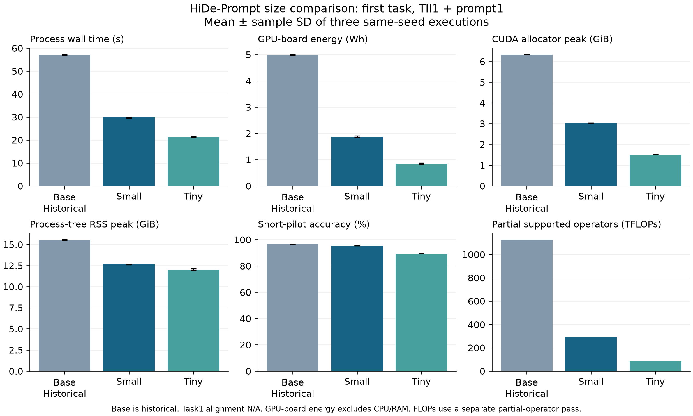

# HiDe-Prompt 크기 확장 결과

Small→Tiny 각각 동일 크기의 독립 저자 코드와 첫 2태스크를 검증했습니다. 논문 수치 재현이나 전체 10태스크 결과로 해석하지 않습니다.

| 크기 | 지표 | 저자 (%) | native (%) | 저자−native (%p) | 판정 |
|---|---|---:|---:|---:|---|
| Small | task1_seen | 98.300 | 98.300 | 0.000 | pass |
| Small | task2_seen | 96.550 | 96.550 | 0.000 | pass |
| Small | task2_old | 97.600 | 97.600 | 0.000 | pass |
| Small | task2_new | 95.500 | 95.500 | 0.000 | pass |
| Tiny | task1_seen | 97.100 | 97.100 | 0.000 | pass |
| Tiny | task2_seen | 93.800 | 93.800 | 0.000 | pass |
| Tiny | task2_old | 94.400 | 94.400 | 0.000 | pass |
| Tiny | task2_new | 93.200 | 93.200 | 0.000 | pass |

허용 하락: 1.5%p 이내 통과, 1.5~3.0%p 추가 점검, 3.0%p 초과 실패. 실제 NPZ의 top1 정답 수/샘플 수를 재계산하고 입력·초기화·구조·첫 배치 조건도 통과해야 합니다. 서로 다른 크기 간 정확도 차이를 구현 실패로 판정하지 않습니다.

첫 태스크 pilot은 공통 `ease` 전처리, batch64, seed1993, workers4, GPU1, FP32/CPU2, TII1+prompt1입니다. TII MLP 비율은 모두 2이며 prefix 길이5·첫 5개 layer를 유지합니다. 첫 태스크 CA는 해당 없음입니다. Base는 보존한 이전 pilot을 재사용하므로 실행 시점·소스 차이를 포함합니다.

| 크기 | pilot 정확도 (%) | 벽시간 (s) | GPU 보드 (Wh) | CUDA peak (GiB) | RSS peak (GiB) | 부분 FLOPs (TF) |
|---|---:|---:|---:|---:|---:|---:|
| Base (기존) | 96.600 ± 0.000 | 57.093 ± 0.152 | 4.992 ± 0.015 | 6.334 ± 0.000 | 15.526 ± 0.044 | 1126.989 |
| Small | 95.400 ± 0.000 | 29.780 ± 0.145 | 1.879 ± 0.030 | 3.032 ± 0.000 | 12.627 ± 0.019 | 296.624 |
| Tiny | 89.400 ± 0.000 | 21.317 ± 0.177 | 0.854 ± 0.023 | 1.507 ± 0.000 | 12.042 ± 0.097 | 81.595 |

평균 ± 표본 표준편차는 동일 seed의 측정 3회 실행 비용 변동입니다. 별도 부분 FLOPs 1회의 비용을 제외했으며, seed 간 불확실성이나 전체 CL 성능·망각을 추정하지 않습니다.

[PDF 그림](efficiency_comparison.pdf)

| 크기 | 측정 W&B | 별도 FLOPs W&B |
|---|---|---|
| Base | [run1](https://wandb.ai/laymond1/cl-efficiency/runs/ne0nyvqg) · [run2](https://wandb.ai/laymond1/cl-efficiency/runs/odcfe4ze) · [run3](https://wandb.ai/laymond1/cl-efficiency/runs/osbkx1m0) | [run](https://wandb.ai/laymond1/cl-efficiency/runs/eq6s491r) |
| Small | [run1](https://wandb.ai/laymond1/cl-efficiency/runs/0u4exsu8) · [run2](https://wandb.ai/laymond1/cl-efficiency/runs/1y9xhpl8) · [run3](https://wandb.ai/laymond1/cl-efficiency/runs/g72qiksj) | [run](https://wandb.ai/laymond1/cl-efficiency/runs/yb6ug2vz) |
| Tiny | [run1](https://wandb.ai/laymond1/cl-efficiency/runs/3v6d59sr) · [run2](https://wandb.ai/laymond1/cl-efficiency/runs/bqt9jgte) · [run3](https://wandb.ai/laymond1/cl-efficiency/runs/4odkdchj) | [run](https://wandb.ai/laymond1/cl-efficiency/runs/79vrr9lb) |

GPU 보드 에너지는 전체 머신 에너지와 다릅니다. 단계 타이머는 중첩되어 총 비용으로 합산할 수 없습니다. 부분 FLOPs는 미지원 연산과 CPU clustering 등을 누락할 수 있습니다. IN21K→IN1K 계열은 같지만 선택한 파일명 기준 Base는 aug_medium·weight decay0.1, Small은 aug_light1·0.03, Tiny는 aug_none·0.03입니다. 크기 비교에는 이 사전학습 recipe 차이도 포함됩니다.

[JSON 결과](results.json) · [CSV 결과](results.csv)
