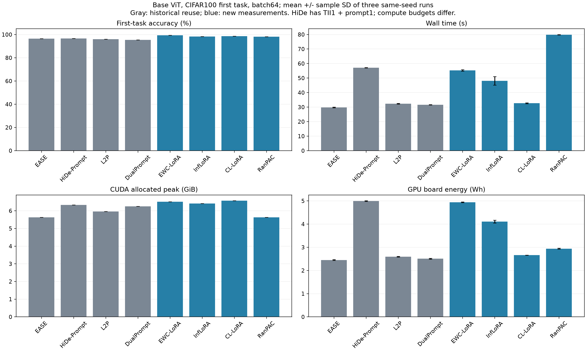

# Base 첫 태스크: 승인된 방법의 부분 효율성 보고서

보고서 상태: **partial_completed**. 현재 승인된 비교는 8방법입니다. 요청한 전체9방법·신규20실행이 모두 통과한 결과가 아닙니다.

신규 승인 기록은 측정12회와 별도 부분 FLOPs4회입니다. EASE·L2P·DualPrompt·HiDe-Prompt는 원본 데이터·전처리·가중치·precision을 대조한 기존 기록을 재사용했습니다.

SD-LoRA의 첫 측정은100/1000(10.0%)로 비정상 정확도 검사를 통과하지 못했습니다. 해당 관측은 격리하고 나머지 SD측정2회·FLOPs1회를 보류했습니다. 원인은 아직 확정되지 않았으며 별도 진단 증거를 검토합니다. SD 관측과 진단 실행은 평균·표준편차·비교 그림에 포함하지 않습니다.

CIFAR100 첫10클래스(train5000/test1000), ViT-B/16 AugReg IN21K→IN1K, batch64, seed1993, GPU1, FP32입니다. 신규 방법은1epoch, HiDe는TII1+prompt1입니다. 방법별 task-begin/end 작업을 포함하므로 동일 계산 예산 비교가 아닙니다.

| 승인된 방법 | 정확도 % | 학습 시간 s | 벽시간 s, 평균±SD | CUDA peak GiB | RSS peak GiB | CPU s | GPU 보드 Wh, 평균±SD | 부분 TFLOPs |
|---|---:|---:|---:|---:|---:|---:|---:|---:|---:|
| EASE | 96.50 | 13.34 | 29.81 ± 0.24 | 5.625 | 13.032 | 41.86 | 2.451 ± 0.019 | 562.696 |
| HiDe-Prompt | 96.60 | 26.18 | 57.09 ± 0.15 | 6.334 | 15.526 | 91.50 | 4.992 ± 0.015 | 1126.989 |
| L2P | 96.00 | 19.55 | 32.38 ± 0.22 | 5.956 | 17.693 | 41.67 | 2.595 ± 0.015 | 618.443 |
| DualPrompt | 95.40 | 18.65 | 31.61 ± 0.07 | 6.248 | 17.571 | 40.90 | 2.508 ± 0.018 | 591.147 |
| EWC-LoRA | 99.30 | 22.27 | 55.27 ± 0.52 | 6.511 | 14.542 | 68.18 | 4.939 ± 0.014 | 914.223 |
| InfLoRA | 98.30 | 16.96 | 48.09 ± 2.96 | 6.411 | 15.200 | 167.51 | 4.107 ± 0.058 | 910.806 |
| CL-LoRA | 98.60 | 15.11 | 32.66 ± 0.26 | 6.569 | 13.570 | 46.29 | 2.660 ± 0.004 | 921.721 |
| RanPAC | 98.10 | 13.79 | 79.83 ± 0.12 | 5.625 | 16.540 | 141.30 | 2.941 ± 0.017 | 564.711 |

학습 시간은 `train_epoch` 관측 구간의 평균입니다. HiDe는 TII와 prompt 학습 구간의 합계입니다. 아래 태스크 경계·평가 구간은 별도로 기록했으며 중첩된 statistics 구간을 다시 더하지 않습니다.

| 승인된 방법 | begin_task s | end_epoch s | end_task s | evaluation s |
|---|---:|---:|---:|---:|
| EASE | 0.01 | 0.00 | 6.54 | 1.46 |
| HiDe-Prompt | 0.01 | 8.45 | 8.37 | 2.62 |
| L2P | 0.00 | 0.00 | 0.00 | 2.49 |
| DualPrompt | 0.00 | 0.00 | 0.00 | 2.49 |
| EWC-LoRA | 0.00 | 0.00 | 21.78 | 1.73 |
| InfLoRA | 9.03 | 0.00 | 11.42 | 1.65 |
| CL-LoRA | 0.01 | 0.00 | 7.03 | 1.52 |
| RanPAC | 0.00 | 0.00 | 55.46 | 1.53 |

[PDF 그림](efficiency_comparison.pdf)

평균±표본 SD는 동일 seed의 실행 비용 변동입니다. 별도 profiler 실행의 시간·메모리·에너지는 평균에서 제외했습니다. GPU 보드 에너지는 CPU/RAM/전체 머신 에너지를 포함하지 않습니다. 부분 FLOPs는 CPU 선형대수·미지원 연산 등 전체 연산을 보장하지 않습니다.

기존 기록은 측정 날짜·소스가 다르며 EASE의 Torch CPU thread 수는 미기록입니다. 같은 augmentation recipe라도 방법별 RNG 경로 때문에 실제 crop은 달라질 수 있습니다. 전체10태스크 정확도·망각·동일 예산 성능을 추정하지 않습니다.

첫 태스크에서는 EWC의 과거 지식 penalty, CL의 KD/과거 branch 학습, Inf의 과거 subspace 상호작용 비용이 나타나지 않습니다. Fisher·feature/SVD/GPM·프로토타입·RanPAC RP/ridge는 실제 수행한 범위로 포함합니다. RanPAC은 실제 학습 전처리와 task-end 특징 추출 전처리를 별도로 기록합니다.

| 승인된 방법 | 측정 실행 | 별도 FLOPs |
|---|---|---|
| EASE | [측정1](https://wandb.ai/laymond1/cl-efficiency/runs/zrctmk8h) · [측정2](https://wandb.ai/laymond1/cl-efficiency/runs/fzn84ciy) · [측정3](https://wandb.ai/laymond1/cl-efficiency/runs/qitfg8hb) | [진단](https://wandb.ai/laymond1/cl-efficiency/runs/tuk4smi4) |
| HiDe-Prompt | [측정1](https://wandb.ai/laymond1/cl-efficiency/runs/ne0nyvqg) · [측정2](https://wandb.ai/laymond1/cl-efficiency/runs/odcfe4ze) · [측정3](https://wandb.ai/laymond1/cl-efficiency/runs/osbkx1m0) | [진단](https://wandb.ai/laymond1/cl-efficiency/runs/eq6s491r) |
| L2P | [측정1](https://wandb.ai/laymond1/cl-efficiency/runs/6mrhex87) · [측정2](https://wandb.ai/laymond1/cl-efficiency/runs/e3zw7v1l) · [측정3](https://wandb.ai/laymond1/cl-efficiency/runs/e0l8cncz) | [진단](https://wandb.ai/laymond1/cl-efficiency/runs/1bmon0eh) |
| DualPrompt | [측정1](https://wandb.ai/laymond1/cl-efficiency/runs/cejvk8hh) · [측정2](https://wandb.ai/laymond1/cl-efficiency/runs/ftkmmfzv) · [측정3](https://wandb.ai/laymond1/cl-efficiency/runs/6xdwgmqh) | [진단](https://wandb.ai/laymond1/cl-efficiency/runs/5ft4jzyn) |
| EWC-LoRA | [측정1](https://wandb.ai/laymond1/cl-efficiency/runs/4pj2gg6i) · [측정2](https://wandb.ai/laymond1/cl-efficiency/runs/qf742cjd) · [측정3](https://wandb.ai/laymond1/cl-efficiency/runs/qff347rm) | [진단](https://wandb.ai/laymond1/cl-efficiency/runs/z8rfk6r3) |
| InfLoRA | [측정1](https://wandb.ai/laymond1/cl-efficiency/runs/0hkqn8x6) · [측정2](https://wandb.ai/laymond1/cl-efficiency/runs/c48mmpgw) · [측정3](https://wandb.ai/laymond1/cl-efficiency/runs/mdz5wjkl) | [진단](https://wandb.ai/laymond1/cl-efficiency/runs/eq6jy6t4) |
| CL-LoRA | [측정1](https://wandb.ai/laymond1/cl-efficiency/runs/pu8aoq3o) · [측정2](https://wandb.ai/laymond1/cl-efficiency/runs/abqwuhpm) · [측정3](https://wandb.ai/laymond1/cl-efficiency/runs/qfphz277) | [진단](https://wandb.ai/laymond1/cl-efficiency/runs/ajmnni6m) |
| RanPAC | [측정1](https://wandb.ai/laymond1/cl-efficiency/runs/ot5d5s8o) · [측정2](https://wandb.ai/laymond1/cl-efficiency/runs/hxuek81z) · [측정3](https://wandb.ai/laymond1/cl-efficiency/runs/f2nxrt3p) | [진단](https://wandb.ai/laymond1/cl-efficiency/runs/di08hugu) |

| 격리 관측 | 실제 정확도 | 판정 | 실행 기록 |
|---|---:|---|---|
| SD-LoRA 측정1 | 10.0% (100/1000) | 정확도 검사 실패·집계 제외 | [W&B](https://wandb.ai/laymond1/cl-efficiency/runs/v8txpwax) |

별도 SD 진단 상태: `completed`. 관측된 진단 분류: `author_reproduces_native_feature_collapse`. 이는 효율성 집계와 SD 승인 판정에 영향을 주지 않으며 원인 검토를 위한 별도 증거입니다.

동일 초기값·첫 배치·79회 업데이트에서 저자 코드도10.0%를 기록했습니다. 첫 그래디언트·최종 모델의 모든 텐서·1000개 예측이 현재 구현과 완전히 일치했습니다. 이 조건의 원형 일치는 확인됐으며, 공통 전처리와 기존 LR0.008 조합의 학습 안정성은 추가 검토가 필요합니다. 전처리나 학습률 중 어느 요인이 붕괴를 일으켰는지는 이 대조만으로 확정하지 않습니다.

[별도 진단 W&B](https://wandb.ai/laymond1/cl-efficiency/runs/nm808wp6)
