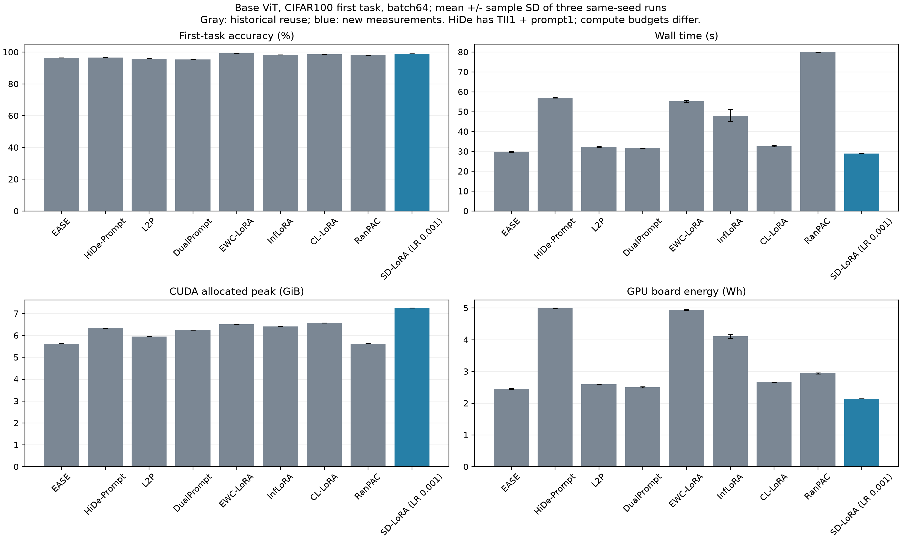

# Base 첫 태스크: SD-LoRA 회복 후 9방법 효율성 pilot

SD-LoRA는 공통 crop 최소값 0.05를 유지하고 LoRA·scale LR만 0.001로 낮췄습니다. classifier LR은 0.008이며 모델 기본 설정과 기존 결과는 그대로 보존했습니다.

저장된 독립 저자 결과 99.0%와 native 첫 태스크 99.0%를 대조했습니다. 저자 대비 하락폭은 0.0%p로 1.5%p 통과 기준과 정확도 90% 하한을 통과했습니다. native 검증 1회와 저자 진단은 효율성 평균에 포함하지 않습니다.

신규 SD 측정 3회·별도 부분 FLOPs 1회를 기존 승인된 8방법 기록과 합쳤습니다. 기존 SD 10.0% 관측은 격리된 실패 증거로 유지하며 보류했던 원래 3실행은 재작성하지 않습니다.

CIFAR100 첫 10클래스(train 5000/test 1000), ViT-B/16 AugReg IN21K→IN1K, batch 64, seed 1993, GPU 1, FP32입니다. 첫 태스크의 전체 79업데이트와 13구조 검사를 확인했습니다. HiDe는 TII 1epoch+prompt 1epoch이며 방법별 task-begin/end 연산을 포함합니다.

| 방법 | 정확도 % | 학습 시간 s | 벽시간 s, 평균±SD | CUDA peak GiB | RSS peak GiB | CPU s | GPU 보드 Wh, 평균±SD | 부분 TFLOPs |
|---|---:|---:|---:|---:|---:|---:|---:|---:|
| EASE | 96.50 | 13.34 | 29.81 ± 0.24 | 5.625 | 13.032 | 41.86 | 2.451 ± 0.019 | 562.696 |
| HiDe-Prompt | 96.60 | 26.18 | 57.09 ± 0.15 | 6.334 | 15.526 | 91.50 | 4.992 ± 0.015 | 1126.989 |
| L2P | 96.00 | 19.55 | 32.38 ± 0.22 | 5.956 | 17.693 | 41.67 | 2.595 ± 0.015 | 618.443 |
| DualPrompt | 95.40 | 18.65 | 31.61 ± 0.07 | 6.248 | 17.571 | 40.90 | 2.508 ± 0.018 | 591.147 |
| EWC-LoRA | 99.30 | 22.27 | 55.27 ± 0.52 | 6.511 | 14.542 | 68.18 | 4.939 ± 0.014 | 914.223 |
| InfLoRA | 98.30 | 16.96 | 48.09 ± 2.96 | 6.411 | 15.200 | 167.51 | 4.107 ± 0.058 | 910.806 |
| CL-LoRA | 98.60 | 15.11 | 32.66 ± 0.26 | 6.569 | 13.570 | 46.29 | 2.660 ± 0.004 | 921.721 |
| RanPAC | 98.10 | 13.79 | 79.83 ± 0.12 | 5.625 | 16.540 | 141.30 | 2.941 ± 0.017 | 564.711 |
| SD-LoRA (LR 0.001) | 99.00 | 18.45 | 28.98 ± 0.03 | 7.264 | 14.411 | 38.97 | 2.143 ± 0.004 | 391.393 |

학습 시간은 train_epoch 구간의 평균이며 HiDe는 TII와 prompt 구간의 합계입니다. 벽시간에는 초기화·데이터 로딩·태스크 경계·평가·감사·체크포인트 저장을 포함하고 최종 W&B 업로드는 제외합니다.

[PDF 그림](efficiency_comparison.pdf)

평균±표본 SD는 동일 seed를 사용한 실행 비용의 변동입니다. 검증·저자 진단·별도 profiler의 시간·메모리·에너지는 평균에서 제외했습니다. GPU 보드 Wh는 CPU/RAM/전체 머신 에너지를 포함하지 않습니다. 부분 FLOPs는 지원 연산의 추정이며 CPU 선형대수와 미지원 연산 등 모든 비용을 포함하지 않습니다.

SD는 안정성 확인을 거친 별도 LR 설정입니다. 이 비교는 동일 계산 예산, 전체 10태스크 성능·망각, 여러 seed의 성능 재현을 평가하지 않습니다. 첫 태스크에는 EWC의 과거 지식 penalty, CL의 과거 branch/KD, Inf의 과거 subspace 상호작용이 나타나지 않습니다. 측정된 Fisher·feature/SVD/GPM·프로토타입·RP/ridge 비용은 포함했습니다.

기존 기록은 날짜·소스·단계 예산이 다릅니다. EASE의 Torch CPU thread 수는 미기록으로 남깁니다. 같은 원본 데이터·augmentation recipe라도 방법별 RNG 경로에 따라 실제 crop은 달라질 수 있습니다.

| 방법 | 측정 실행 | 별도 FLOPs |
|---|---|---|
| EASE | [측정1](https://wandb.ai/laymond1/cl-efficiency/runs/zrctmk8h) · [측정2](https://wandb.ai/laymond1/cl-efficiency/runs/fzn84ciy) · [측정3](https://wandb.ai/laymond1/cl-efficiency/runs/qitfg8hb) | [진단](https://wandb.ai/laymond1/cl-efficiency/runs/tuk4smi4) |
| HiDe-Prompt | [측정1](https://wandb.ai/laymond1/cl-efficiency/runs/ne0nyvqg) · [측정2](https://wandb.ai/laymond1/cl-efficiency/runs/odcfe4ze) · [측정3](https://wandb.ai/laymond1/cl-efficiency/runs/osbkx1m0) | [진단](https://wandb.ai/laymond1/cl-efficiency/runs/eq6s491r) |
| L2P | [측정1](https://wandb.ai/laymond1/cl-efficiency/runs/6mrhex87) · [측정2](https://wandb.ai/laymond1/cl-efficiency/runs/e3zw7v1l) · [측정3](https://wandb.ai/laymond1/cl-efficiency/runs/e0l8cncz) | [진단](https://wandb.ai/laymond1/cl-efficiency/runs/1bmon0eh) |
| DualPrompt | [측정1](https://wandb.ai/laymond1/cl-efficiency/runs/cejvk8hh) · [측정2](https://wandb.ai/laymond1/cl-efficiency/runs/ftkmmfzv) · [측정3](https://wandb.ai/laymond1/cl-efficiency/runs/6xdwgmqh) | [진단](https://wandb.ai/laymond1/cl-efficiency/runs/5ft4jzyn) |
| EWC-LoRA | [측정1](https://wandb.ai/laymond1/cl-efficiency/runs/4pj2gg6i) · [측정2](https://wandb.ai/laymond1/cl-efficiency/runs/qf742cjd) · [측정3](https://wandb.ai/laymond1/cl-efficiency/runs/qff347rm) | [진단](https://wandb.ai/laymond1/cl-efficiency/runs/z8rfk6r3) |
| InfLoRA | [측정1](https://wandb.ai/laymond1/cl-efficiency/runs/0hkqn8x6) · [측정2](https://wandb.ai/laymond1/cl-efficiency/runs/c48mmpgw) · [측정3](https://wandb.ai/laymond1/cl-efficiency/runs/mdz5wjkl) | [진단](https://wandb.ai/laymond1/cl-efficiency/runs/eq6jy6t4) |
| CL-LoRA | [측정1](https://wandb.ai/laymond1/cl-efficiency/runs/pu8aoq3o) · [측정2](https://wandb.ai/laymond1/cl-efficiency/runs/abqwuhpm) · [측정3](https://wandb.ai/laymond1/cl-efficiency/runs/qfphz277) | [진단](https://wandb.ai/laymond1/cl-efficiency/runs/ajmnni6m) |
| RanPAC | [측정1](https://wandb.ai/laymond1/cl-efficiency/runs/ot5d5s8o) · [측정2](https://wandb.ai/laymond1/cl-efficiency/runs/hxuek81z) · [측정3](https://wandb.ai/laymond1/cl-efficiency/runs/f2nxrt3p) | [진단](https://wandb.ai/laymond1/cl-efficiency/runs/di08hugu) |
| SD-LoRA (LR 0.001) | [측정1](https://wandb.ai/laymond1/cl-efficiency/runs/iqq2qznu) · [측정2](https://wandb.ai/laymond1/cl-efficiency/runs/e4e7caje) · [측정3](https://wandb.ai/laymond1/cl-efficiency/runs/8q1qe499) | [진단](https://wandb.ai/laymond1/cl-efficiency/runs/9bl4pw37) |

[SD native 검증 W&B](https://wandb.ai/laymond1/cl-efficiency/runs/s2k8kf54)

저자 99.0% 기록은 기존 로컬 진단의 원본 SHA와 함께 별도 보존합니다. 최종 보고서에 보관하더라도 당시 학습이 W&B 온라인으로 실행된 것으로 바꾸지 않습니다.

| 격리 관측 | 정확도 | 처리 |
|---|---:|---|
| [기존 SD-LoRA](https://wandb.ai/laymond1/cl-efficiency/runs/v8txpwax) | 10.0% | 원본 보존·집계 제외 |
